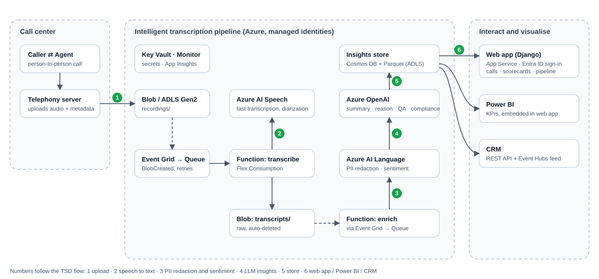
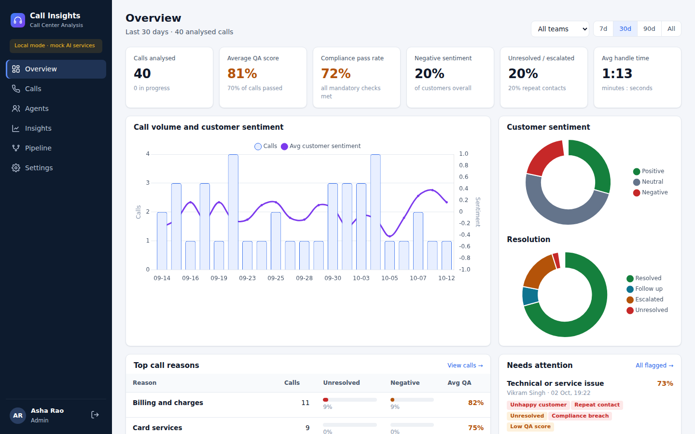
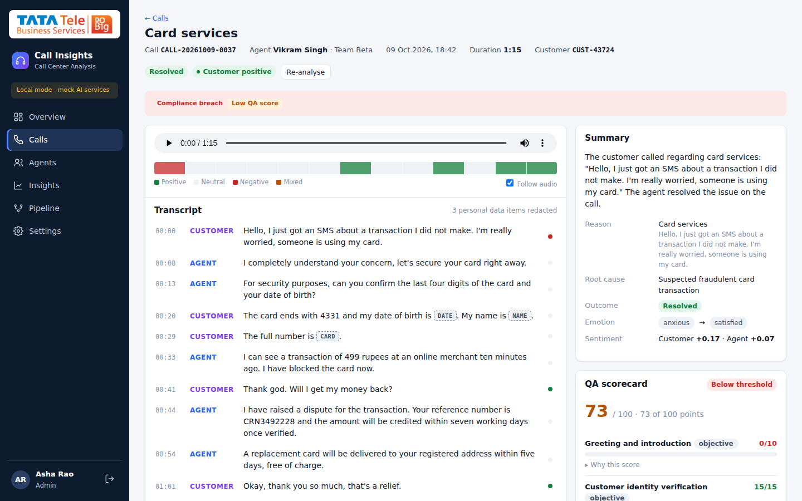

# Call Center Analysis

Automated post-call analytics for contact centres on Azure. Every recorded call goes through the same steps:

1. It is transcribed.
2. Personal data is redacted from the transcript.
3. The call is scored for sentiment, emotion, QA criteria and compliance.
4. It gets a summary, a call reason and a root cause.

Supervisors, QA teams and agents see the results in a secure web app and in Power BI. The CRM can pull them through an API or an event feed.

The solution is a deployable template. You choose the tier (SKU) of every Azure service in one parameters file and deploy with one command or the **Deploy to Azure** button.

[](https://portal.azure.com/#create/Microsoft.Template/uri/https%3A%2F%2Fraw.githubusercontent.com%2FTTNS-Deployments%2FCall-Center-Analysis%2Fmain%2FDeployment%2FARM%2Fazuredeploy.json/createUIDefinitionUri/https%3A%2F%2Fraw.githubusercontent.com%2FTTNS-Deployments%2FCall-Center-Analysis%2Fmain%2FDeployment%2FARM%2FcreateUiDefinition.json)

> The button deploys the infrastructure. The application code is deployed by `Deployment/scripts/deploy.sh` or the *Deploy* GitHub workflow (see [Deployment guide](Documents/deployment-guide.md)). The button only works if this repository is public, or if the template URLs point to a location the portal can read.

### Overview

Every Azure resource is defined in a single ARM template, `azuredeploy.json`. SKUs shown are the dev defaults; the demo and prod values are in the [SKU reference](Deployment/README.md).

| # | Name | Description | Service | Template |
|---|------|-------------|---------|----------|
| 1 | Key Vault | Holds every secret the stack generates | Key Vault (standard, RBAC) | azuredeploy.json |
| 2 | Data lake | Recordings, raw transcripts, insights, config and app packages | Storage (ADLS Gen2, Standard_LRS) | azuredeploy.json |
| 3 | Eventing | Queues each new recording or transcript with retries and poison handling | Event Grid + Storage queues | azuredeploy.json |
| 4 | Monitoring | Logs and application telemetry | Log Analytics, Application Insights | azuredeploy.json |
| 5 | Pipeline compute | Runs the `transcribe` and `enrich` stages and the poison handlers | Azure Functions (Flex Consumption FC1, max 40 instances) | azuredeploy.json |
| 6 | Speech to text | Transcribes calls with speaker separation | Azure AI Speech (S0) | azuredeploy.json |
| 7 | PII and sentiment | Redacts PII and scores sentiment per utterance | Azure AI Language (S) | azuredeploy.json |
| 8 | LLM insights | Summary, reason, root cause, QA scorecard and compliance as strict JSON | Azure OpenAI `gpt-5-mini` (GlobalStandard, 30K TPM, South India) | azuredeploy.json |
| 9 | Database | One document per call for the web app and CRM API | Cosmos DB for NoSQL (Serverless) | azuredeploy.json |
| 10 | Analytics store | Parquet tables read by Power BI | Parquet files in the data lake | azuredeploy.json |
| 11 | Web app | Django UI, CRM REST API, Power BI embed tokens | App Service (B1, Linux) | azuredeploy.json |
| 12 | Event feed | One event per analysed call for the CRM (optional) | Event Hubs (Basic, 1 TU; on in prod) | azuredeploy.json |
| 13 | Identity | Sign-in and roles: Admin, Supervisor, QA, Agent | Entra ID app registration | setup_entra.sh |

Defender for Cloud (a subscription-level plan) and Power BI licensing are not deployed by the template.

<br/>

## Architecture



| # | Step | Azure service |
|---|------|---------------|
| 1 | The telephony server uploads the recording (and optional metadata JSON) | Blob Storage / ADLS Gen2 |
| 2 | Speech to text with speaker separation | Azure AI Speech (fast transcription) |
| 3 | PII detection and redaction, per-utterance sentiment, **before** any LLM call | Azure AI Language |
| 4 | Summary, call reason, root cause, resolution, emotion, QA scorecard, compliance checks | Azure OpenAI (structured JSON output) |
| 5 | Insights stored for apps (document per call) and analytics (Parquet) | Cosmos DB, ADLS Gen2 |
| 6 | Web app, embedded Power BI, CRM API and event feed | App Service (Django), Power BI, Event Hubs |

Orchestration: an Event Grid `BlobCreated` event feeds a Storage queue, which feeds a queue-triggered Azure Function on the **Flex Consumption** plan. Each stage retries on its own, and calls that keep failing appear on the Pipeline page with a Retry button. All service-to-service access uses **managed identities**, and the only secrets live in Key Vault.

How to use the web app: [User guide](Documents/user-guide.md) · More detail: [Architecture](Documents/architecture.md) · [Technical specification](Documents/technical-specification.md)

<br/>

## Screens

| Overview | Call detail |
|---|---|
|  |  |

- **Overview:** KPIs, volume and sentiment trend, top call reasons, flagged calls, root causes, agent leaderboard.
- **Calls:** search and filter by agent, team, reason, sentiment, resolution, flag and QA range.
- **Call detail:** an audio player synced with the redacted transcript, a sentiment strip, the summary, a QA scorecard with evidence quotes, the compliance checklist and coaching tips.
- **Agents / My scorecard:** per-agent QA, compliance and sentiment, with the weakest criteria to coach on.
- **Insights:** the embedded Power BI report, with built-in charts until the report is published.
- **Pipeline:** processing status, failures with retry, and a test upload.
- **Settings:** edit the QA rubric, compliance checks and call reasons. No redeploy is needed.

Who sees what is controlled by Entra ID app roles:

| Role | Access |
|---|---|
| **Admin** | Everything, including settings |
| **Supervisor** | All calls, agents, insights and the pipeline (not Settings) |
| **QA** | All calls, agents and insights |
| **Agent** | Their own calls and their own scorecard |

<br/>

## Quick start (local mode, no Azure needed)

Local mode replaces every Azure dependency with a local equivalent:

| Azure service | Local replacement |
|---|---|
| Storage | A folder |
| Cosmos DB | SQLite |
| Speech, Language and OpenAI | Mocks with realistic output |
| Entra ID | Demo users |

```bash
make setup     # creates .venv and installs everything
make seed      # generates and analyses 40 synthetic English calls
make run       # http://localhost:8000 – pick a demo user (Admin, Supervisor, QA or an Agent)
make test
```

Without `make`:

```bash
python3 -m venv .venv && . .venv/bin/activate
pip install -r requirements-dev.txt
python -m callcenter seed
cd Code/webapp && python manage.py runserver
```

**Moving to real services:** copy `.env.example` to `.env` and set the variables for one service at a time, for example `LLM_BACKEND=azure` with `AZURE_OPENAI_ENDPOINT`, `AZURE_OPENAI_KEY` and `AZURE_OPENAI_DEPLOYMENT`. Everything else stays mocked. The `make` targets load `.env`; when you run Python directly, export the variables in your shell instead. See [Local development](Documents/local-development.md) and [Configuration](Documents/configuration.md).

Docker alternative: `make docker-up` runs the web app with the Azurite storage emulator.

<br/>

## Deploy to Azure

1. **Choose SKUs.** Edit [`Deployment/ARM/parameters/dev.parameters.json`](Deployment/ARM/parameters/dev.parameters.json) or `prod.parameters.json`. Every tier and size is a parameter; see the [SKU reference](Deployment/README.md).
2. **Deploy** infrastructure and code, and create the Entra ID app registration with roles:
```bash
   az login
   Deployment/scripts/deploy.sh -g rg-callcenter-dev -e dev --setup-entra
```
3. Open the web app URL printed at the end and sign in. You are assigned the Admin role. Assign other users to roles in *Entra admin center → Enterprise applications*.
4. Point the telephony server at the `recordings` container (see the [telephony contract](Documents/technical-specification.md#1-recording-ingestion)).
5. Optional: publish the Power BI report ([Analytics/README.md](Analytics/README.md)).

Full steps, CI/CD with GitHub Actions and troubleshooting are in the [Deployment guide](Documents/deployment-guide.md).

<br/>

## Repository layout

| Path | Contents |
|---|---|
| [`Code/core`](Code/core) | `callcenter` Python package: pipeline, Speech/Language/OpenAI clients (mock and Azure), storage, call store, analytics, CLI |
| [`Code/functions`](Code/functions) | Azure Functions app (queue triggers for the two pipeline stages and poison handling) |
| [`Code/webapp`](Code/webapp) | Django web app: UI, Entra ID sign-in, CRM REST API, Power BI embedding |
| [`Config`](Config) | QA rubric, compliance checks, call reason taxonomy (YAML, editable at runtime) |
| [`Deployment/ARM`](Deployment/ARM) | ARM template, per-environment SKU parameter files, portal form for the Deploy button |
| [`Deployment/scripts`](Deployment/scripts) | `deploy.sh`, `setup_entra.sh`, `package.sh` |
| [`Analytics`](Analytics) | Power BI data model: Power Query sources, DAX measures, report and embedding guide |
| [`Data/sample_calls`](Data/sample_calls) | Synthetic call scripts for local mode and demos |
| [`Documents`](Documents) | Architecture, technical specification, deployment guide, configuration, local development |
| [`.github/workflows`](.github/workflows) | CI (tests) and Deploy (manual, per environment) |

<br/>

## Status and roadmap

| Phase | Scope | Status |
|---|---|---|
| 1 | Post-call analysis: recording, transcription, PII redaction, sentiment, QA, compliance, insights, web app, Power BI, CRM API | Implemented (sample QA rubric and compliance scripts, to be replaced with the customer's) |
| 2 | Real-time transcription and agent assist during the call | Planned: Event Hubs is provisioned when `deployEventHubs` is `true` (the prod parameters file); see [Architecture → Phase 2](Documents/architecture.md#phase-2-real-time) |

Calls can be in English (`en-US`) or Hindi (`hi-IN`), or set to auto-detect between the two (the Language field on the upload form, or `"locale"` in the sidecar JSON). PII redaction and sentiment run in the spoken language. Insights are always written in English, and evidence is quoted as spoken. Hindi accuracy has not been validated on real recordings yet, and local mode's mock services are English only.

<br/>

## Support

See [SUPPORT.md](SUPPORT.md). Security issues: [SECURITY.md](SECURITY.md).
